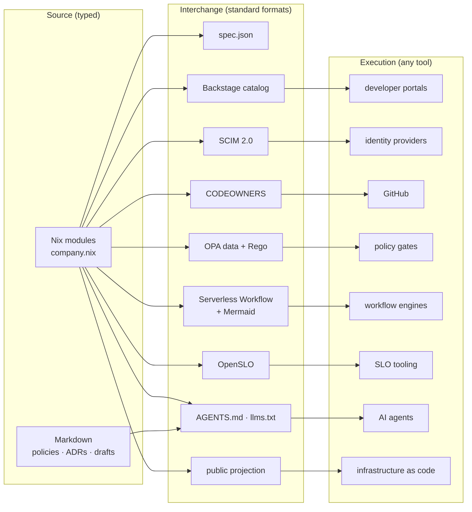
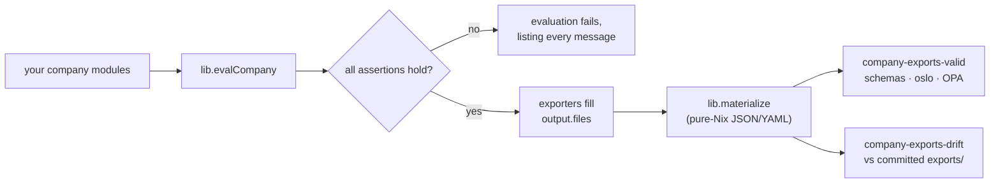
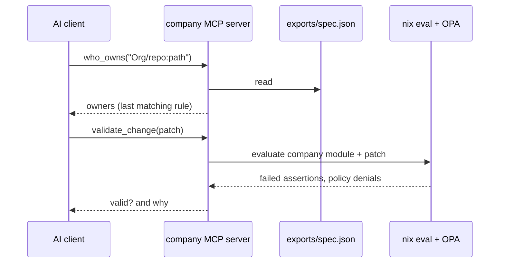

<div id="top">
    <div align="center">
        
        <h1 align='center'>company-framework</h1>
        <strong>Typed Nix description of a company that compiles to community-standard formats</strong>
    </div>

</div>

______________________________________________________________________

<div align='center'>
    <a href="https://github.com/Qezta/company-framework/stargazers">
        
    </a>
    <a href="https://github.com/Qezta/company-framework/">
        
    </a>
    <a href="https://github.com/Qezta/company-framework/blob/main/LICENSE">
        
    </a>
    <a href="https://github.com/nixos/nixpkgs">
        
    </a>
    
</div>

______________________________________________________________________

<div align='center'>
    <a href="https://github.com/Qezta/company-framework/actions/workflows/ci.yml">
        
    </a>
</div>

______________________________________________________________________

## Contents

- [Overview](#overview)
- [Quick start](#quick-start)
- [Installation](#installation)
- [Usage](#usage)
- [How it works](#how-it-works)
- [Configuration](#configuration)
- [AI agents (MCP)](#ai-agents-mcp)
- [Development](#development)
- [License](#license)

______________________________________________________________________

## Overview

> **Status: experimental (0.x).** Options and export formats may change between minor versions.

A typed, Nix-native description of a company — its entity, people, roles,
domains and systems — that compiles to formats existing tools already read.



- **Humans read it → Markdown.** Policies, ADRs, SOPs.
- **Machines check it → Nix.** Roles, people, ownership, systems.
- **Tools consume it → their native format.** No tool ever has to read Nix.
- **Generated exports are committed** and CI fails on drift, so the data is never trapped in Nix.

## Quick start

```sh
mkdir my-company && cd my-company
nix flake init -t github:Qezta/company-framework
git init && git add -A
nix flake check
```

## Installation

Add the flake as an input:

```nix
inputs.company-framework.url = "github:Qezta/company-framework";
```

Requires Nix with flakes enabled. Evaluation is pure: no network access and no
import-from-derivation.

## Usage

### With flake-parts

```nix
{
  imports = [ inputs.company-framework.flakeModules.company ];
  company.modules = [ ./company.nix ];
  # company.exportsDir = "exports";   # default
}
```

This adds:

| Output | What it is |
| --- | --- |
| `packages.<system>.exports` | The full export tree |
| `packages.<system>.spec` | `spec.json` on its own |
| `apps.<system>.update-exports` | Copies the export tree into `exportsDir` |
| `checks.<system>.company-exports-drift` | Fails if committed exports are stale |
| `checks.<system>.company-exports-valid` | Validates every export against its standard and runs the OPA policies |

### Without flake-parts

The core depends only on nixpkgs `lib`:

```nix
let
  company = inputs.company-framework.lib;
  eval = company.evalCompany { modules = [ ./company.nix ]; };
in
  company.materialize { inherit pkgs; files = company.checkedFiles eval; }
```

`checkedFiles` throws with every failed assertion listed;
`failedAssertions eval.config` returns them as a list instead.

## How it works



Every reference, cycle, date and identity rule is checked before anything is
written, and every export is validated against its own standard.

## Configuration

A company is one module setting `company.*`. The full reference is
[docs/options.md](docs/options.md); [docs/standards.md](docs/standards.md)
maps every export to its standard. See
[`examples/acme/acme.nix`](examples/acme/acme.nix) for a fictional company
that uses every option.

| Option | Holds |
| --- | --- |
| `company.entity` | Names, jurisdiction, public registration ids, domains, contacts, links, brand |
| `company.people.<id>` | Name, email, GitHub login, roles, status, start/end dates |
| `company.roles.<id>` | Description, parent role, GitHub team + permission, responsibilities |
| `company.domains.<id>` | Description, owning role |
| `company.systems.<id>` | Type, lifecycle, domain, owner, repo, CODEOWNERS rules, dependencies, links |
| `company.policies.<id>` | Title, owner, Markdown doc, review cadence, machine rules for OPA |
| `company.processes.<id>` | Owner, trigger, inputs, and a DAG of steps (task, approval, automated, decision) |
| `company.reliability.slos.<id>` | System, indicator, target, window, metric source |
| `company.pricing` | Currency and plans (prices in minor units) |
| `company.decisionsDir` | MADR decision records, read into `company.decisions` |
| `company.root` | Directory Markdown paths are relative to |
| `company.asOf` | Reference date for date-relative checks (evaluation cannot read the clock) |
| `company.exports.<name>.enable` | Toggle each exporter |

Every reference is checked (roles, parents, owners, domains, dependencies,
CODEOWNERS), the role tree must be acyclic, dates must be real calendar dates,
GitHub-mapped roles need a `githubUser`, and team slugs must be unique.

## AI agents (MCP)

`nix run .#mcp` starts a read-only [Model Context Protocol](https://modelcontextprotocol.io)
server over stdio, backed by your committed `exports/spec.json` (re-read on
every call). Point an MCP client at it, for example in Claude Code's
`.mcp.json`:

```json
{ "mcpServers": { "company": { "command": "nix", "args": ["run", ".#mcp"] } } }
```

| Tool | Returns |
| --- | --- |
| `get_entity` | Names, jurisdiction, contacts, links, brand |
| `list_people(status?)` | People, optionally filtered by status |
| `get_role(role_id)` | Role with members and child roles |
| `who_owns(target)` | Owner of a system, a repo, or `Org/repo:path` (last CODEOWNERS rule wins) |
| `get_policy(policy_id)` | Policy metadata, rules and Markdown text |
| `get_process(process_id)` | Steps, roles, approvers, SLAs |
| `validate_change(patch)` | Runs the full Nix evaluation and OPA policies with `patch` overlaid; writes nothing |



`validate_change` needs `nix` on `PATH` and `company.mcp.module` set to your
company module file (e.g. `"company.nix"`).

## Development

```sh
nix develop                 # dev shell with every tool
nix fmt                     # format
update-all                  # regenerate acme + template exports and docs/options.md (dev shell)
nix flake check -L          # all checks
```

See [AGENTS.md](AGENTS.md) for contribution rules and
[docs/adr](docs/adr) for design decisions.

## License

[MIT](LICENSE)

<div align="right">

[![][back-to-top]](#top)

</div>

[back-to-top]: https://img.shields.io/badge/-BACK_TO_TOP-151515?style=flat-square&color=purple
